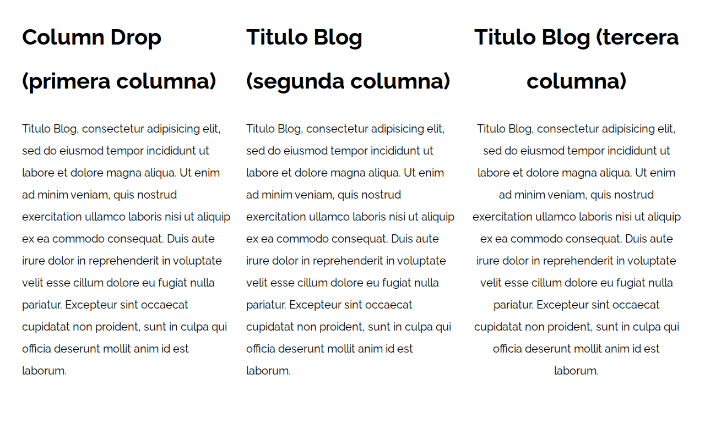
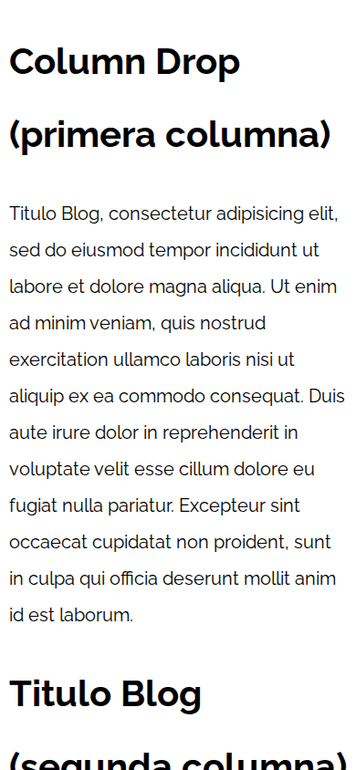
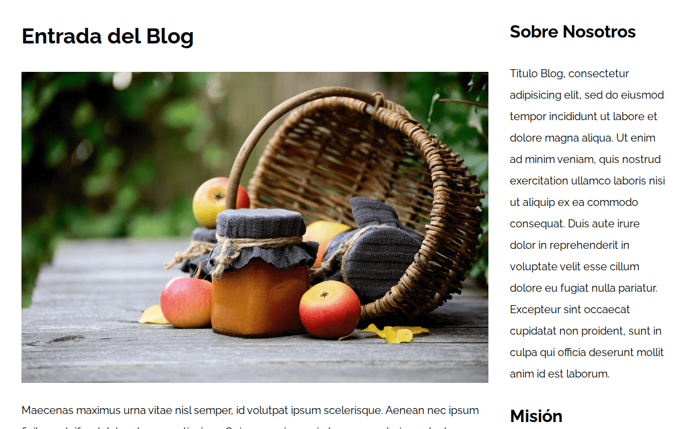
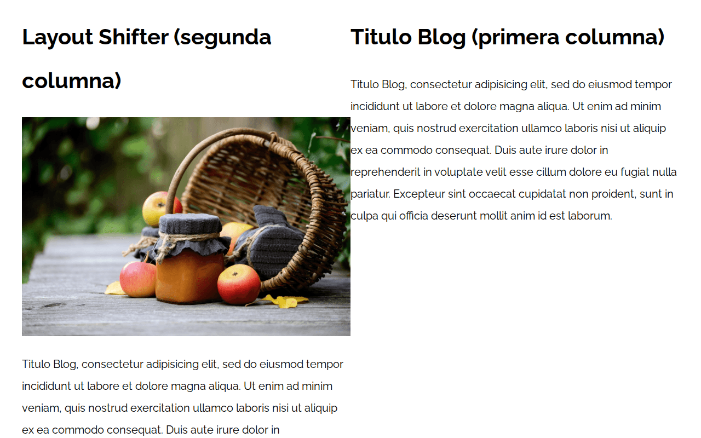

# Patrones de diseño web responsive con CSS Grid y Flexbox

> **Proyecto de formación.** Ejercicios del curso *Desarrollo Web Completo* de
> Juan Pablo De la Torre Valdez ([Código Con Juan](https://codigoconjuan.com)).


Catálogo de 14 patrones de maquetación responsive. Los doce primeros están resueltos dos veces,
una con **CSS Grid** y otra con **Flexbox**, para comparar las dos técnicas con el mismo
HTML. Todos siguen un enfoque *mobile first* con *media queries* `min-width` a 480, 768
y 992 px.

## Patrones

| # | Patrón | Grid | Flexbox |
|---|---|---|---|
| 1–2 | Dos columnas iguales | [01](01-2columnas_iguales_css_grid) | [02](02-2columnas_iguales_flexbox) |
| 3–4 | Tres columnas iguales | [03](03-3columnas_iguales_css_grid) | [04](04-3columnas_iguales_flexbox) |
| 5–6 | Tres columnas | [05](05-3columnas_css_grid) | [06](06-3columnas_flexbox) |
| 7–8 | Column drop | [07](07-column_drop_css_grid) | [08](08-column_drop_flexbox) |
| 9–10 | Contenido con sidebar | [09](09-con_sidebar_css_grid) | [10](10-con_sidebar_flexbox) |
| 11–12 | Layout shifter | [11](11-layout_shifter_css_grid) | [12](12-layout_shifter_flexbox) |
| 13 | Mostly fluid | [13](13-mostly_fluid) · anchos fluidos y *media queries* | |
| 14 | Tiny tweaks | [14](14-tiny_tweaks) · ajustes de tipografía y espaciado | |

## Capturas

| Column drop · escritorio | Column drop · móvil |
|---|---|
|  |  |
| **Contenido con sidebar** | **Layout shifter** |
|  |  |

## Stack

- HTML5 y CSS3 (CSS Grid, Flexbox, *media queries*), normalize.css y Google Fonts.
- Sin JavaScript ni herramientas de compilación.

## Cómo ejecutarlo en local

```bash
git clone git@github.com:ricardo-mendez-saoprojects/Patrones-Web-Design.git
cd Patrones-Web-Design
python3 -m http.server 8000
```

Abre `http://localhost:8000/01-2columnas_iguales_css_grid/` (o cualquier otra carpeta) y
cambia el ancho de la ventana para ver cómo se reorganiza.

## Estructura

```
├── 01-2columnas_iguales_css_grid/
│   ├── index.html
│   ├── css/styles.css
│   └── img/
├── 02-2columnas_iguales_flexbox/
└── …                    una carpeta autónoma por patrón (14 en total)
```

## Créditos

Ejercicios de la sección de patrones de diseño responsive del curso *Desarrollo Web
Completo* de Juan Pablo De la Torre Valdez ([Código Con Juan](https://codigoconjuan.com)).

<details>
<summary><strong>English</strong></summary>

# Responsive web design patterns with CSS Grid and Flexbox

> **Learning project.** Exercises from the *Desarrollo Web Completo* course by
> Juan Pablo De la Torre Valdez ([Código Con Juan](https://codigoconjuan.com)).

A catalogue of 14 responsive layout patterns. The first twelve are solved twice, once with
**CSS Grid** and once with **Flexbox**, to compare both techniques on the same HTML. All of
them are mobile first, with `min-width` media queries at 480, 768 and 992 px.

## Patterns

Two equal columns, three equal columns, three columns, column drop, content with sidebar and
layout shifter (each in Grid and Flexbox), plus mostly fluid and tiny tweaks (fluid widths and media queries, no Grid or Flexbox). See the table
above for the folder of each one.

## Screenshots

See the table above.

## Stack

- HTML5 and CSS3 (CSS Grid, Flexbox, media queries), normalize.css and Google Fonts.
- No JavaScript and no build tools.

## Running locally

```bash
git clone git@github.com:ricardo-mendez-saoprojects/Patrones-Web-Design.git
cd Patrones-Web-Design
python3 -m http.server 8000
```

Open `http://localhost:8000/01-2columnas_iguales_css_grid/` (or any other folder) and resize
the window to see the layout change.

## Structure

One self-contained folder per pattern (14 in total), each with `index.html`,
`css/styles.css` and `img/`.

## Credits

Exercises from the responsive design patterns section of the *Desarrollo Web Completo*
course by Juan Pablo De la Torre Valdez ([Código Con Juan](https://codigoconjuan.com)).

</details>
